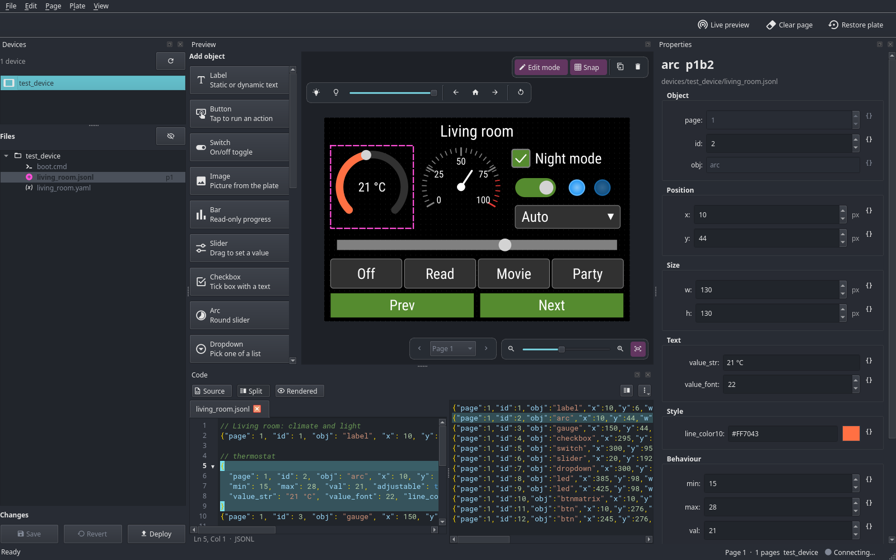

# openhasp-config-manager

The missing management layer for your openHASP setup. A powerful suite of tools to simplify hardware UI design, combining
a logic-aware config engine with a robust API client and deployment automation.

# Features

🏗️ Advanced Configuration Engine

* 🏠 Centralized Management: Manage an unlimited fleet of devices from one folder structure with shared configuration support.
* 🛠️ Smart JSONL Preprocessing:
  * **Multiline Support:** Write clean, readable blocks instead of giant single-line strings.
  * **Jinja2 Templating:** Power your UI with logic, math, and cross-object variables (e.g., `{{ p1b1.y + 10 }}`).
  * **Comments:** Use `//` to document your layout logic directly inside your `.jsonl` files.
  * **YAML Variables:** Define global and local variables to reuse values across your entire setup.
  * **Parts:** Write repeating objects once and include them anywhere with `!include`, with variables and loops.
* 🎨 **Global Theme Engine:** Define styles (colors, fonts, radii) once and apply them to all objects instantly.

🚢 Smart Deployment & Validation

* 🛡️ **Early Error Detection:** Automatically catch syntax mistakes in .jsonl and .cmd files before they hit your hardware.
* 🔄 **Delta Deployments:** Save time and flash wear—only upload what changed.
* 🔍 **Visual Diffs:** Review exactly what will change with a git-style +/- line-by-line output.
* 📺 **GUI Preview (WIP):** Inspect and prototype your screens in a digital previewer before deploying. It follows changes to the config files on disk, so you can edit them with a text editor or an LLM at the same time.

🔌 API & Interaction

* 📡 **Unified API Client:** Interact with your plates via a single Python interface over Web or MQTT.
* ⚡ **Command Execution:** Send openHASP commands programmatically.
* 🔔 **Real-time Events:** Subscribe to button presses, state updates, and touch events as they happen.
* 🪄 **AppDaemon Integration Utilities:** Seamlessly integrate with AppDaemon for advanced automations and logic.

# GUI



A graphical editor for your config directory: preview the pages of a plate, edit objects visually or as text, and deploy.
The preview and the text editor follow each other, and both follow changes to the files on disk, so you can also edit them
with another editor or an LLM at the same time. Hints, shortcuts and explanations are in the GUI itself (hover over things,
use the context menus, and the legend of the file tree).

With *Edit mode* off, the preview is an *Interact mode*: touching the objects looks and behaves like on a plate with openHASP
0.7 (pressed looks, toggles, dragged sliders and arcs, dropdown lists, rollers that are dragged and thrown, tabs that are swiped, message boxes, `action` with page
navigation, groups and commands like `p1b2.val 1`). What you touch is only shown and never changes the files; *Reset* (or Edit mode) puts the objects
back as the files say.

The GUI has additional dependencies (PyQt6) and is optional:

```shell
pip3 install 'openhasp-config-manager[gui]'
openhasp-config-manager gui -c "./openhasp-configs"
```

## Working with an LLM next to the GUI

The config files are plain text, so an LLM (or any tool) can edit them while the GUI is open. For context the files don't
have, the GUI keeps `.openhasp-config-manager/gui-state.json` in the config directory up to date: the device and page that are
open, the selected objects (with file and line), the unsaved changes, the warnings and errors the GUI shows, files it can't load
and the connection to the plate. The folder is ignored by git and has a `README.md` that describes the format. Without the GUI,
`openhasp-config-manager check -c <config dir>` prints the same problems (and what a deployment would fail on) for all devices,
as text or `--json`, and exits with 1 on errors. Variables no device uses are listed as `hint`s (they don't fail the check).

Tell your LLM about it, e.g. in the `AGENTS.md` or `CLAUDE.md` of your config repository:

```markdown
While the openhasp-config-manager GUI runs, `.openhasp-config-manager/gui-state.json` tells what the user has open and which
problems the GUI shows (see the README in that folder). Edit only the config files.
```

# CLI

```shell
> openhasp-config-manager -h
Usage: openhasp-config-manager [OPTIONS] COMMAND [ARGS]...

Options:
  --version   Show the version and exit.
  -h, --help  Show this message and exit.

Commands:
  check       Checks the config directory for errors and warnings,...
  cmd         Sends a command request to a device.
  deploy      Combines the generation and upload of a configuration.
  generate    Generates the output files for all devices in the given...
  help        Show this message and exit.
  listen      Sends a state update request to a device.
  logs        Prints the logs of a device.
  screenshot  Requests a screenshot from the given device and stores it...
  shell       Connects to the telnet server of a device.
  state       Sends a state update request to a device.
  upload      Uploads the previously generated configuration to their...
  vars        Prints the variables accessible in a given path.
```

# 🛠️ Project Status

I use `openhasp-config-manager` **exclusively** to manage my own openHASP devices. While it is my "daily driver", please keep in mind:

* **In Development:** I’m actively adding tests and refining features to make it more robust.
* **Rough Edges:** Error logging is still a bit basic. If something goes wrong, the logs might require some "detective work" to figure out the exact cause.
* **Experimental:** It’s stable for my needs, but since every openHASP setup is unique, you might run into edge cases I haven't hit yet.

If you like the project and want to help polish those error logs or add features, I’m always happy to review an issue or a PR!

# Setup

## Docker

```
docker run -it --rm \
  --name openhasp-config-manager \
  --user 1000:1000 \
  -v "./openhasp-configs:/app/openhasp-configs" \
  -v "./output:/app/output" \
  ghcr.io/markusressel/openhasp-config-manager
```

## Installation

Since openhasp-config-manager needs some dependencies (see [here](/pyproject.toml)) it is
**recommended to install it inside a virtualenv**.

### venv-install

[venv-install](https://github.com/markusressel/venv-install) is a little helper tool to ease the
installation, management and usage of python cli tools in venvs.

```bash
venv-install openhasp-config-manager openhasp-config-manager
openhasp-config-manager -h
```

### Manual
<details>
<summary><b>Manual Installation & Uninstallation</b></summary>

```bash
mkdir -p ~/venvs/openhasp-config-manager
python3 -m venv ~/venvs/openhasp-config-manager
source ~/venvs/openhasp-config-manager/bin/activate
pip3 install openhasp-config-manager
```

The graphical editor (`openhasp-config-manager gui`) has additional dependencies (PyQt6) and is optional:

```bash
pip3 install 'openhasp-config-manager[gui]'
```

And to use it:

```shell
source ~/venvs/openhasp-config-manager/bin/activate
openhasp-config-manager -h
openhasp-config-manager analyze -c "./openhasp-configs"
...
```

### Uninstall

```bash
deactivate
rm -rf ~/venvs/openhasp-config-manager
```

</details>


## Getting Started

openhasp-config-manager is first and foremost a configuration
management system. Simply follow the basic folder structure and
config deployment will become trivial. **Please read all of this,
as it is very important to understand the basic structure on
which everything relies.**

### 📁 Folder Structure

The following folders should reside inside a single parent
folder, f.ex. named `openhasp-configs`. This folder can be
located anywhere you like, but must be accessible to
openhasp-config-manager when executing.

* `common`: The `common` subdirectory can be used for files
  that should be included on _all_ device. This folder is optional.
* `devices`: The `devices` folder is required. It must contain one
  subfolder for each openHASP device you want to configure using
  openhasp-config-manager. It is recommended to name subfolders according
  to the physical devices associated with them.
  * `touch_down_1` (example device folder)
    * A device folder contains `*.jsonl`, `*.cmd` and other files which should
      only be uploaded to that particular device.
    * You can create arbitrary nested folder structures for organizing the files.
      There is a limit to the file name length though,
      see [FAQ](#output-file-name-length-must-not-exceed-30-characters)
    * You must provide a `config.json` file, see [config.json](#config.json)
      for more info.

A more advanced configuration layout could look something like this:

```text
openhasp-configs
├── common
│   ├── content
│   │   └── card.jsonl
│   ├── dialog
│   │   ├── connected.jsonl
│   │   └── offline.jsonl
│   ├── navigation_bar.jsonl
│   └── page_header.jsonl
└── devices
    └── touch_down_1
        ├── 0_home
        │   ├── 0_header.jsonl
        │   ├── 1_content.jsonl
        │   └── page.cmd
        ├── 5_about
        │   ├── 0_header.jsonl
        │   ├── 1_content.jsonl
        │   └── page.cmd
        ├── boot.cmd
        ├── config.json
        ├── offline.cmd
        └── online.cmd
```

### ⚙️ Plate Setup (`config.json`)

openhasp-config-manager makes use of the `config.json` on your plate by extracting information
like the screen orientation. It even allows you to deploy changes within the `config.json` file.

> Note: Since [the official API does not support
uploading the full file](https://github.com/HASwitchPlate/openHASP/issues/363), only settings
which can also be set through the web ui on the plate itself are currently supported.
 
**However**, the official `config.json` file doesn't provide enough info for openhasp-config-manager
to enable all of its features. To fix that we need to add a custom section to the file.

1. Download your config.json via the openHASP web browser, see [official docs](https://www.openhasp.com/latest/faq/?h=web#is-there-a-file-browser-built-in).
2. Append the `openhasp_config_manager` block, adjusting the values as needed.

```json
{
  "openhasp_config_manager": {
    "device": {
      "ip": "192.168.5.134",
      "screen": {
        "width": 320,
        "height": 480
      }
    }
  },
  "wifi": {
    "ssid": "Turris IoT",
    ...
  }
  ... rest of config ...
```

### 🧠 Config File Preprocessing

openhasp-config-manager runs all configuration files through various preprocessors, which allow us to use
features the original file formats do not support by themselves, like f.ex. templating.

#### 📝 Multiline JSONL files

While the JSONL file format requires each object to be on a single line, openhasp-config-manager
allows you to add as many line breaks as you wish. This makes it much easier to edit, since a config
like this:

```json
{
  "page": 0,
  "id": 31,
  "obj": "msgbox",
  "text": "%ip%",
  "auto_close": 5000
}
```

will be deployed like this:

```json lines
{"page": 0, "id": 31, "obj": "msgbox", "text": "%ip%", "auto_close": 5000}
```

#### Comments

Neither JSON nor JSONL allows comments, but openhasp-config-manager does!
You can mark comments by prefixing them with a double forward-slash:

```json5
// File description
{
  // Object Description
  "page": 0,
  "id": 31,
  // Property Description
  "obj": "msgbox",
  "text": "%ip%",
  "auto_close": 5000
}
```

#### 🪄 Templating

You can use Jinja2 templates inside all jsonl object values. To access the value of another object in a
template, you can use the `pXbY` syntax established by openHASP, where `X` is the `page` of an object and
`Y` is its `id`. openhasp-config-manager even tries to resolve templates that lead to other templates.
Be careful not to create loops in this way though.

You can use the full functionality of Jinja2 like f.ex. math operations, function calls or type conversions.

```yaml
{
  "page": 1,
  "id": 1,
  "x": 0,
  "y": 0,
  ...
}

  {
    "page": 1,
    "id": 2,
    "x": "{{ p1b1.x }}",
    "y": "{{ p1b1.y + 10 }}",
    ...
  }
```

The numeric properties of other objects (`page`, `id`, `x`, `y`, `w`, `h`, `min`, `max`, `radius`, `border_width`,
`pad_*`, `margin_*`, ...) are numbers, with percentages already turned into pixels, so you can calculate with them directly:
`"{{ p1b1.x + p1b1.w + 4 }}"`. Other properties are text, as they are written.

Two shorter names help with objects of the same page:

* `this` is the object itself: `"w": "{{ this.h }}"` makes it square, `"text": "Page {{ this.page }}"`.
* `bY` is the object with the id `Y` on the page of the object, like `pXbY` without the page:
  `"x": "{{ b4.x + common.card.padding }}"` instead of `"x": "{{ p{{ common.pages.printer.index }}b4.x + common.card.padding }}"`.

Like `pXbY`, they work for objects later in the file, for the object itself and for objects of other files of the device.
They can't be used in `page` and `id` (these say which object it is), and inside of object templates they hide variables
with the same names.

#### 📦 Variables & Scoping

Besides accessing other objects, you can also define custom variables yourself, which can then
be referenced inside of templates. Variables are defined using `*.yaml` files. If you
decided to use a subfolder structure to organize your configuration files you can use these folders
to also set the scope of variables. More specific variable definitions (longer path) will override
less specific ones.
Variables can be computed from other variables (see [Computed values](#computed-values)), and an `!include` can pass
variables of its own to the objects it includes (see [Including objects](#including-objects)).

##### Global

Global variables can be specified by creating `*.yaml` files inside the root config folder (f.ex. `openhasp-configs`).

Example:

`openhasp-configs/global.vars.yaml`

```yaml
about:
  page_title: "About"
```

To access this variable, use a Jinja2 template:

`openhasp-configs/common/about_page.jsonl`

```json lines
{
  "page": 9,
  "id": 1,
  ...
  "title": "{{ about.page_title }}",
  ...
}
```

##### Device specific

Device specific variables can be specified by creating `*.yaml` files inside any of the sub-folders
of a `device` folder.

> **Note**
>
> Device specific variables will override global variables, given the same name.

Example:

`openhasp-configs/device/my_device/device.vars.yaml`

```yaml
page_title: "My Device"
```

`openhasp-configs/device/my_device/some_folder/some_page.jsonl`

```json lines
{
  "page": 1,
  "id": 1,
  ...
  "title": "{{ page_title }}",
  ...
}
```

`openhasp-configs/device/my_device/some_other_folder/some_page.jsonl`

```json lines
{
  "page": 2,
  "id": 1,
  ...
  "title": "{{ page_title }}",
  ...
}
```

##### Computed values

The values of variables can be templates themselves, computed from other variables and from `device` (the
`openhasp_config_manager.device` section of the device's `config.json`, e.g. `device.screen.width`):

`openhasp-configs/global.vars.yaml`

```yaml
common:
  margin: 4
  card:
    x: "{{ common.margin }}"
    w: "{{ device.screen.width - common.margin * 2 }}"
    padding: 6
    inner_w: "{{ common.card.w - common.card.padding * 2 }}"
```

* A value is computed with the variables of the path it is used in, so a device that overrides `common.margin` gets its
  own `common.card.w`. For files in `common`, that includes the variables of the device folder.
* The order of the definitions doesn't matter. Variables that depend on each other in a cycle, or names that don't exist,
  are errors (`check` and a deployment report them).
* A value that is a single template (`"{{ ... }}"`) is the value of the expression: a number, a list, ... Other text with
  templates stays text, unless it is a number.
* Objects (`p1b2`) can't be used in variables: variables are computed before the objects. Use them in the objects instead.
* If a value should keep its braces, write it as `"{{ text }}"`.

#### Printing variables

If you are not sure what variables are accessible in a given path, you can use the `vars`
command, which will give you a copy&paste ready output of all variables for a
given directory (with computed values; for a path in a device folder with the `device` of that device):

```shell
> openhasp-config-manager vars -c openhasp-configs -p devices/touch_down_1/home
common.navbar.first_page: 1
common.navbar.last_page: 4
...
header.title: Home
```

#### 🎨 Theming

To specify default property values for an object type, simply define them as a variable
under `theme.obj.<obj-type>`, where `<obj-type>` is the value of the `obj` property of the object.

The keys used must conform to the naming of the object properties as specified in OpenHasp, see:
https://www.openhasp.com/latest/design/objects/

For example, to make the background color of all buttons red by default, define:

`theme.yaml`
```yaml
theme:
  obj:
    btn:
      bg_color: "#FF0000"
```

in a global variable file named `theme.yaml` located at the root of your configurations directory
`openhasp-configs/theme.yaml`.

#### Including objects

Objects that repeat (a caption with its value, the dots of a page indicator, a row of buttons) can be written once in a
`.jsonl` file of their own, a "part", and included where they are needed with an `!include` object:

```json lines
{
  "!include": "common/parts/tile/tile.jsonl",
  "vars": {"page": 3, "id": 10, "x": 10, "y": 50, "caption": "Elapsed"}
}
```

* `!include` is the path of the part, relative to the config directory, written as it is (no templates). Like every file of a
  device, it must be in `common/` or in the folder of the device.
* The objects of the part replace the `!include` object, in their order.
* `vars` (optional) are variables for the part. Their values may be templates, computed from the variables of the including
  file.
* `for` (optional) includes the part once for every value of a loop variable: a list, or a single template like
  `"{{ range(1, 6) }}"`. With several loop variables, the part is included for every combination, the first one changing
  slowest.
* A part is a normal JSONL file: its parameters are the variables used in its templates. It can include other parts.
* An object is either an openHASP object or an `!include`, never both. The plate never sees an `!include`.

The part computes the ids of its objects from its variables (`"id": "{{ id + 1 }}"`). Included objects have their names
before the templates of the objects are rendered, so they can be referred to like all others (`p3b11.y`, `b11.y`), and they
can refer to the objects of the including file and to each other.

##### Example: tiles

`openhasp-configs/common/parts/tile/tile.jsonl`

```json lines
// a caption with a value below it. Parameters: page, id (the value gets id + 1), x, y, caption
{"page": "{{ page }}", "id": "{{ id }}", "obj": "label", "x": "{{ x }}", "y": "{{ y }}", "w": "{{ tile.w }}", "text": "{{ caption }}"}
{"page": "{{ page }}", "id": "{{ id + 1 }}", "obj": "label", "x": "{{ x }}", "y": "{{ tile.value_y }}", "w": "{{ tile.w }}", "text": "-"}
```

`openhasp-configs/common/parts/tile/tile.yaml`

```yaml
tile:
  w: 140
  value_y: "{{ y + 22 }}"
```

`openhasp-configs/devices/my_device/printer.jsonl`

```json lines
{"page": 3, "id": 1, "obj": "label", "x": 10, "y": 10, "text": "Printer"}
{
  // two tiles next to each other: ids 10 and 11, 12 and 13
  "!include": "common/parts/tile/tile.jsonl",
  "vars": {"page": 3, "id": "{{ 10 + column * 2 }}", "x": "{{ 10 + column * 150 }}", "y": 50,
           "caption": "{{ ['Elapsed', 'Remaining'][column] }}"},
  "for": {"column": [0, 1]}
}
{"page": 3, "id": 20, "obj": "bar", "x": 10, "y": "{{ b11.y + 40 }}", "w": 290, "h": 10}
```

##### Example: a page indicator

Five dots at the bottom of each of the pages 1 to 5, the dot of the page highlighted:

`openhasp-configs/common/parts/page_indicator/dot.jsonl`

```json lines
{
  "page": "{{ page }}",
  "id": "{{ 200 + dot }}",
  "obj": "obj",
  "x": "{{ dots.x + dot * dots.step }}",
  "y": "{{ device.screen.height - dots.size - 4 }}",
  "w": "{{ dots.size }}",
  "h": "{{ dots.size }}",
  "radius": "{{ dots.size // 2 }}",
  "bg_color": "{{ dots.active_color if dot == page - 1 else dots.color }}",
  "click": 0
}
```

`openhasp-configs/common/parts/page_indicator/dot.yaml`

```yaml
dots:
  count: 5
  size: 8
  step: 16
  color: "#555555"
  active_color: "#FFFFFF"
  x: "{{ (device.screen.width - dots.count * dots.step) // 2 }}"
```

`openhasp-configs/common/page_indicator.jsonl`

```json lines
{"!include": "common/parts/page_indicator/dot.jsonl", "for": {"page": "{{ range(1, 6) }}", "dot": "{{ range(5) }}"}}
```

##### Variables of a part

A part sees, later ones winning:

1. the variables of its own folders (`common/parts/tile/tile.yaml` above): its defaults,
2. the variables of the including file (for a part included by a part: those of that part's instance),
3. `vars`,
4. the loop variables of `for`.

A default whose value is a template is computed with all of them (`tile.value_y` uses the `y` of the instance). A device or a
page can override a default, so give the defaults of a part names of their own (like `tile.*`) if they shouldn't be
overridden by accident. The values of `vars` can use the loop variables (`"id": "{{ 10 + column * 2 }}"`), but not objects:
pass the id of an object instead, and refer to it in the part (`"{{ b{{ anchor }}.y }}"`).

##### Deploying, checking and editing parts

* A part that no `.cmd` file runs is not uploaded: the plate gets its objects in the files that include it. Its objects count
  for `pXbY` only through the files that include them.
* `check` and a deployment report the errors of an `!include` (a missing file, a loop of includes, unknown variables, two
  objects with the same page and id, ...) at its line, and errors of included objects at their line in the part, with the
  `!include`s that led there.
* In the GUI, included objects are shown on the pages like all others, but can't be changed there: change them in the part,
  or the `vars` of the `!include`. The properties of an included object link to both. The text editor highlights
  `!include`, opens the part with Ctrl+click on its path, completes the path and explains `vars` and `for` on hover.

## Images and fonts

Put `.png` and `.bin` images, and `.ttf` and `.bin` fonts, anywhere in the `common` folder or a device folder. Like all files they are
uploaded with a flattened name (`devices/plate1/icons/home.png` becomes `icons_home.png`, see
[the file name length](#output-file-name-length-must-not-exceed-30-characters)), and that is the name you refer to.
Only the files that are used are copied to a device:

* **Images** are found by the `L:/` path in your `.jsonl` and `.cmd` files, e.g. `"src": "L:/icons_home.png"`. The text is
  searched after the templates are rendered, so `"src": "L:/icons_{{ name }}.png"` works too. A missing image is an error.
* **Fonts** are referenced by their name on the plate, without `L:/` and without the extension, see the
  [openHASP docs](https://www.openhasp.com/0.7.0/design/fonts/): `"text_font": "fonts_arial_20"` is the binary font `fonts_arial_20.bin`,
  and `"text_font": "fonts_arial20"` is the TrueType font `fonts_arial.ttf` in size 20 (the `.ttf` extension has to be lowercase). The
  `font` of the `hasp` section of `config.json` is searched as well. A font that has no file in the config only produces a warning,
  because it might already be on the plate.
* **Files that are not found in your config files**, e.g. because they are used by MQTT commands from an automation, are copied
  when they match a pattern of the `include_files` variable. It is a list of names on the plate, with `*` and `?` as wildcards. Define it in
  a variable file of the root folder to include them for every device, or in the folder of a device for that device
  (a device's list replaces the global one):

```yaml
include_files:
  - icons_weather_*.png
  - fonts_arial.ttf
```

* **Binary images**: a PNG is decoded into the memory of the plate, while a binary image (`.bin`) is read from flash each time, so it
  needs no PSRAM and no memory. The disadvantage is that openHASP can't use `zoom` and `angle` with it, and the file is bigger. List the PNG
  images that should be converted when they are deployed in the `binary_images` variable (names on the plate, with `*` and `?`, set
  like `include_files`). The references in your files change to the `.bin` file, your sources stay as they are. An image
  that is not fully opaque gets an alpha byte per pixel. The size is the size of the PNG, so scale it as it should be shown.

```yaml
binary_images:
  - icons_*.png
```

## Deployment

To deploy your configurations to the already connected openHASP devices, simply use the
`generate`, `upload` or `deploy` commands of `openhasp-config-manager`.

`deploy` uploads what changed and makes the plate load it. If only pages, commands or PNG images changed, the plate rebuilds its pages
from the files (like after a restart, but faster and without losing the connection). Changed idle timeouts, backlight and cursor
settings are applied to the running plate, like haad does. It restarts if its MQTT, HTTP or rotation settings, fonts or `.bin` files
(could be fonts) changed, because it only loads those at startup. `--restart` restarts it after every change.

> **Note**
> openhasp-config-manager needs direct IP access as well as an enabled webservice on the plate
> to be able to deploy files to the device. To enable the webservice
> try: `openhasp-config-manager cmd -d plate35 -C service -p "start http"`

## Run commands

While openhasp-config-manager is first and foremost a config management system,
it also allows you to run commands on a device by issuing MQTT messages without the need to install a separate
MQTT client first. Note that the MQTT _server_ still needs to be running and also has to
be reachable from your local machine for this to work.

For a list of possible commands to send to a device, take a look at the official
documentation: https://openhasp.haswitchplate.com/latest/commands/

```shell
> openhasp-config-manager cmd -c ./openhasp-configs -d plate35 -C backlight -p "{\"state\":\"on\",\"brightness\":128}"
```

## AppDaemon Integration Utilities

If you want to integrate your openHASP devices with [AppDaemon](https://github.com/AppDaemon/appdaemon), openhasp-config-manager contains
some utilities to make this process easier. They run inside AppDaemon, so AppDaemon itself is not a dependency of this package: use
the `openhasp-config-manager` package from your AppDaemon environment (AppDaemon pins older versions of some libraries).

### Plate Controller

The `OpenHaspController` class provides a high-level interface to manage the state of your plate, send commands and listen to events.
See: [openhasp_config_manager/ad/README.md](openhasp_config_manager/ad/README.md) for more details and examples.

## API Client

If you don't want to use all of the file-tree related features of openhasp-config-manager,
but still want to interact with your openHASP devices using python and the official API,
you can use the `OpenHaspClient` class to do so. It provides a simple interface
to interact with a plate, send commands, listen to events and state updates.

See

- [example.py](example.py)
- [example_image.py](example_image.py)
- [example_jsonl.py](example_jsonl.py)

to see how to use it.

# FAQ

## How do I see device logs?

Try the `logs` command (this does require network access to the device):

```shell
> openhasp-config-manager logs -d plate35
```

It prints the log until you press Ctrl+C, with the parts of a line (time, tag, message) and the errors and warnings highlighted. Useful options:

- `--reconnect` connects again when the connection to the device is lost, e.g. while it restarts.
- `-o plate35.log` also appends the log to a file (without colors).
- `--no-color` turns the highlighting off. It is off anyway if the output is not a terminal.

The status of the connection is printed to stderr, so the log itself can be piped into other tools, e.g. [lnav](https://lnav.org):

```shell
> openhasp-config-manager logs -d plate35 --reconnect | lnav
```

The log is read from the telnet server of the device, which only allows one connection at a time. A second `logs` or `shell`
(or the Logs panel of the GUI) has to wait until the first one is closed.

openHASP doesn't write the level of a message as text, only as the color of the line, and only if the device sends colors
(`"debug": {"ansi": 1}` in its `config.json`). Without it the level is guessed from the tag and words like "failed" or "timeout".
The Logs panel of the GUI notices a plate without colors and offers to turn them on (at once over MQTT, and in the `config.json` of
the device so a deploy keeps it).

If that doesn't work, open a terminal and run the following command with the device connected via USB cable:

```shell
bash -c "screen -q -L -Logfile device.log /dev/ttyUSB0 115200 &> /dev/null; tail -F device.log; killall screen"
```

## Output file name length must not exceed 30 characters

openHASP doesn't support subfolders. To keep your local project organized, the manager flattens your structure 
during upload (e.g., `folder/page.jsonl` becomes `folder_page.jsonl`). So f.ex. the file in the following structure:

```text
openhasp-configs
└── devices
    └── touch_down_1
        └── 0_home
            └── 0_header.jsonl
```

would be uploaded to the `touch_down_1` device with the name `0_home_0_header.jsonl`.

To avoid the "Output file name length must not exceed 30 characters" error, make sure that the
flattened file name (including the device folder prefix) does not exceed 30 characters.

# Contributing

GitHub is for social coding: if you want to write code, I encourage contributions
through pull requests from forks of this repository. Create GitHub tickets for
bugs and new features and comment on the ones that you are interested in.

# License

```text
openhasp-config-manager is free software: you can redistribute it and/or modify
it under the terms of the GNU AFFERO GENERAL PUBLIC LICENSE as published by
the Free Software Foundation, either version 3 of the License, or
(at your option) any later version.

This program is distributed in the hope that it will be useful,
but WITHOUT ANY WARRANTY; without even the implied warranty of
MERCHANTABILITY or FITNESS FOR A PARTICULAR PURPOSE.  See the
GNU General Public License for more details.

You should have received a copy of the GNU General Public License
along with this program.  If not, see <https://www.gnu.org/licenses/>.
```
